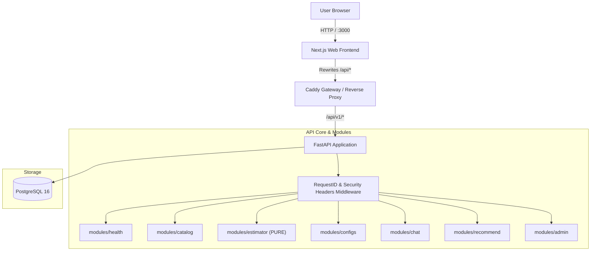

# System Architecture

## Overview
ModelFit is designed with strict boundaries, separation of concerns, and guaranteed deterministic outputs.

## Layering Convention
Inside each backend module:
1. `router.py`: HTTP-only handling, parameter parsing, dependency injection, and HTTP response envelopes.
2. `service.py`: Domain and business logic.
3. `repository.py`: Async database access via SQLAlchemy models.

Modules talk to each other only through service interfaces. The `modules/estimator` is strictly pure: no imports from FastAPI, SQLAlchemy, httpx, or huggingface_hub.
